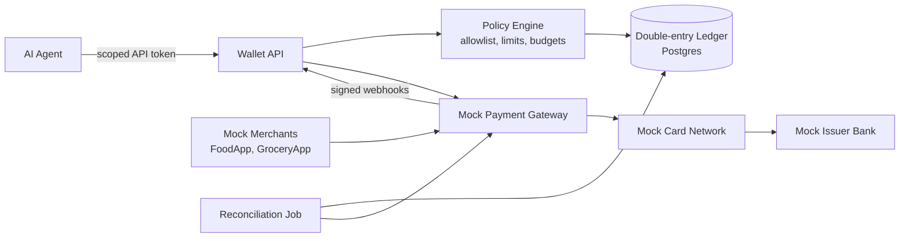

# Agent Wallet: review and plan

Yes, this is a strong project, especially for a backend engineer who wants to work on payments. It also fits a fast-growing area. Google's **AP2 (Agent Payments Protocol)**, **Visa Intelligent Commerce** and **Mastercard Agent Pay** all try to solve the same problem: how to let an AI agent spend money safely.

## One change before you start

You can't get a home-built wallet accepted on Swiggy or Amazon. In India, running a real wallet (a prepaid payment instrument, or PPI) requires an RBI license, KYC checks and a partner bank. So build it in two layers:

1. **Core project:** your own wallet, ledger and payment authorization system, connected to a **simulated card network and merchants**, plus **Razorpay or Stripe in test mode**. This is where the learning happens.
2. **Optional real-world bridge:** these already give an agent limited spending power:
   - **UPI Circle** (delegated payments with a monthly cap)
   - **UPI Lite** (small payments without a PIN)
   - A **virtual card with a low limit** from your bank

   Your system adds the rules on top of whichever one you pick.

## Architecture

The agent **never sees card numbers or OTPs**. It gets a scoped token that can only spend within the wallet's rules.

## Plan (Java 21, Spring Boot 3)

| Phase | What you build | Main concepts |
|---|---|---|
| 1. Ledger (week 1–2) | Accounts, journal entries, balances computed from entries | Double-entry bookkeeping, money stored as `long` paise or `BigDecimal` (never `double`), entries never edited, only reversed |
| 2. Wallet API | Top-up, balance, transaction history | `Idempotency-Key` header, ACID transactions, optimistic locking vs `SELECT … FOR UPDATE`, preventing double-spend under concurrency |
| 3. Payment lifecycle | Authorize → capture → void → refund → partial refund | Holds and available vs ledger balance, payment state machine, hold expiry |
| 4. Mock card network | Merchant → gateway (acquirer side) → card network → issuer, with an OTP step | 4-party model, MDR fees, ISO 8583 basics, 3-D Secure / OTP, tokenization, card number validation (BIN, Luhn), PCI-DSS scope |
| 5. Policy engine | Merchant allowlist, per-transaction / daily / monthly limits, category budgets | Merchant category codes (MCC), velocity checks, rule engine, fraud scoring, human approval above a threshold |
| 6. Reliability | Webhooks, retries, event publishing | Outbox pattern, Kafka, at-least-once delivery + idempotent consumers, sagas, HMAC-signed webhooks, Resilience4j (timeouts and circuit breakers) |
| 7. Settlement and reconciliation | Daily batch that matches your ledger with gateway reports | T+1 settlement, reconciliation breaks, chargebacks and disputes |
| 8. Security and audit | OAuth2/JWT with scopes, audit log, encrypted secrets | Least privilege, key management (KMS/HSM concepts), KYC/AML basics, RBI rules on payment data storage |
| 9. Agent layer | Expose the wallet as an **MCP server** or tool; agent compares prices, waits for sales, and asks for approval when needed | Agentic payments, AP2-style "mandates" (signed proof of what the user allowed the agent to buy) |
| 10. Bonus | Credit card module: billing cycle, statement, minimum due, interest, late fees | Credit vs prepaid products, interest calculation |

**Tech stack:** Spring Boot, Spring Data JPA, PostgreSQL, Flyway, Spring Security, Kafka (or Spring events + outbox), Redis (idempotency keys and rate limiting), Testcontainers, Docker Compose, OpenAPI, Micrometer + Grafana.

**What will impress interviewers:** a concurrency test that fires 1,000 parallel payments at a ₹500 wallet and proves the balance never goes negative and no payment is processed twice.

## Resume entry

**Agent Wallet: Safe Payments Platform for AI Agents** (Java 21, Spring Boot, PostgreSQL, Kafka, Redis)
- Built a prepaid wallet with a double-entry ledger so AI agents can make purchases on their own within user-set limits and an allowlist of merchants.
- Implemented the full payment lifecycle (authorize, capture, void, refund) against a simulated card network, with idempotent APIs and row-level locking; verified no double-spend under 1,000+ concurrent requests.
- Designed a policy engine (merchant allowlist, velocity and budget limits, approval above a threshold), plus reliable event delivery (outbox pattern) and daily reconciliation that flags ledger mismatches.
- Exposed the wallet as an MCP tool with scoped OAuth2 tokens, so the agent never handles card details or OTPs.

Replace the 1,000+ figure with your real test results once you have them.

## What you'll be able to explain in interviews

How money moves between issuer, acquirer and card network; authorization vs settlement; why ledgers are append-only; idempotency and exactly-once processing; handling distributed transactions without two-phase commit (saga and outbox); reconciliation; chargebacks; PCI scope reduction through tokenization; and spending controls. These are standard backend topics at companies like Razorpay, Juspay, PhonePe, Stripe and Adyen.